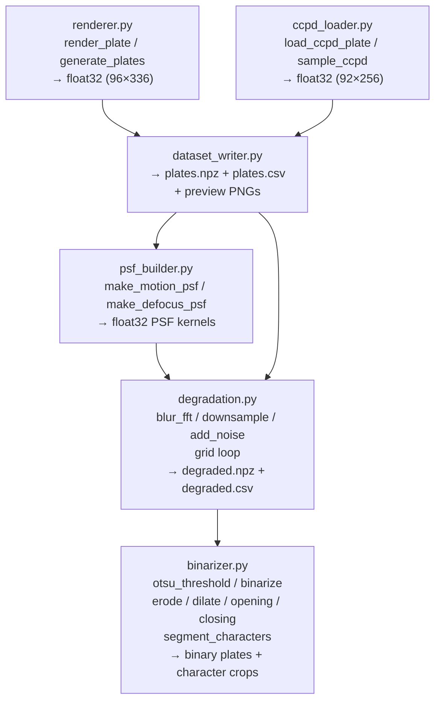

# Design Document

## Overview

This document describes the technical design for a classical (non-deep-learning) license-plate restoration pipeline for the Digital Image Processing course project CS7.404. The system implements three pipeline stages owned by this team member:

- **Step 1** – Clean Plate Acquisition: synthetic Indian plate rendering (1.1), CCPD plate loading (1.2), and dataset persistence (1.3).
- **Step 2** – Degradation: PSF construction (2.1), FFT-based blurring + downsampling (2.2), noise injection (2.2b), and the degradation grid loop (2.3).
- **Step 5** – Binarization: Otsu thresholding (5.1), morphological operations (5.2), and character segmentation (5.3).

The forward degradation model is:

```
g(x,y) = D( h(x,y) * f(x,y) ) + n(x,y)
```

where `f` is the sharp plate (float32 in [0,1]), `h` is the PSF, `*` is convolution, `D` is block-mean downsampling, and `n` is additive Gaussian noise.

All signal-processing primitives are implemented from scratch using NumPy. OpenCV is used only for I/O, perspective warping, and connected components. PIL is used only for text rendering. Matplotlib/Pandas are used only for plots and tables.

---

## Architecture

### Module Structure

```
license_plate_restoration/
├── renderer.py            # Requirement 1 — synthetic Indian plate rendering
├── ccpd_loader.py         # Requirement 2 — CCPD plate loading and sampling
├── dataset_writer.py      # Requirement 3 — .npz + .csv persistence
├── psf_builder.py         # Requirement 4 — motion and defocus PSF construction
├── degradation.py         # Requirements 5, 6, 7 — blur, downsample, noise, grid loop
├── binarizer.py           # Requirements 8, 9, 10 — Otsu, morphology, segmentation
└── data/
    ├── plates.npz         # All clean plates (synthetic + ccpd_base + ccpd_blur)
    ├── plates.csv         # Metadata (id, source, true_text, filename)
    ├── preview_synthetic.png
    ├── preview_ccpd_base.png
    ├── preview_ccpd_blur.png
    └── degraded/
        ├── degraded.npz   # Degraded images + PSFs keyed by reproducible id
        └── degraded.csv   # Degradation parameter log
```

### Data Flow



---

## Components and Interfaces

### renderer.py

```python
def render_plate(text: str, seed: int) -> np.ndarray:
    """
    Returns float32 ndarray of shape (96, 336).
    Raises ValueError if text does not match the Indian plate pattern.
    Uses PIL for text drawing only; NumPy for all other construction.
    """

def generate_plates(n: int, seed: int) -> list[tuple[np.ndarray, str]]:
    """
    Returns n (image, text) pairs with valid Indian registration numbers.
    All texts conform to: [State_Code][space][0-9]{2}[space][A-Z]{2}[space][0-9]{4}
    """

# Internal constants
PLATE_W, PLATE_H = 320, 80   # inner plate area (pixels)
MARGIN = 8                    # grey border width (pixels)
OUT_W, OUT_H = PLATE_W + 2*MARGIN, PLATE_H + 2*MARGIN  # 336, 96
GREY = 128 / 255.0            # margin fill value ≈ 0.502

STATE_CODES = [
    "AP","AR","AS","BR","CG","GA","GJ","HR","HP","JH","KA","KL","MP",
    "MH","MN","ML","MZ","NL","OD","PB","RJ","SK","TN","TS","TR","UP",
    "UK","WB","AN","CH","DN","DD","DL","LD","PY"
]
```

**Plate construction algorithm:**
1. Allocate a `(96, 336)` float32 array filled with `GREY` (margin value).
2. Fill the inner `(80, 320)` region with white (`1.0`).
3. Draw a 2-px black border around the inner region using NumPy slicing.
4. Use `PIL.ImageDraw.Draw.text` with a bold TrueType font to render `text` centred on the inner region. Convert the PIL image to a NumPy array and composite onto the plate.
5. Return the result normalised to `[0, 1]` float32.

The `seed` parameter seeds a `numpy.random.default_rng` used only for font-size jitter (if any) — for completely fixed text layout the seed has no effect on the pixel output, ensuring determinism.

---

### ccpd_loader.py

```python
# CCPD character tables (province index 0 is dropped)
ALPHABETS: list[str]   # 24 letters + "O"
ADS: list[str]         # 24 letters + 10 digits + "O"

def load_ccpd_plate(image_path: str) -> tuple[np.ndarray, str] | None:
    """
    Parses filename for corners and char indices.
    Warps plate to 240×76 using OpenCV perspective transform.
    Adds 8px grey margin → shape (92, 256).
    Returns (float32_array, text) or None on parse/read failure.
    """

def sample_ccpd(
    folder: str, n: int, seed: int
) -> tuple[np.ndarray, np.ndarray, list[str]]:
    """
    Returns (stacked_imgs shape (n,H,W), text_array shape (n,), filenames list).
    Skips malformed files; stops when n valid plates are collected.
    """
```

**Filename parsing:**
- Split on `-`; field index 3 gives four `x&y` corner pairs.
- Field index 4 gives seven integer indices; index 0 is the province (dropped).
- `text = ALPHABETS[idx[1]] + "".join(ADS[i] for i in idx[2:])`, filtering out `"O"` pseudo-characters.

**Perspective warp:**
- Source corners from filename; destination corners define a `240×76` rectangle (bottom-right → top-left order as in `build_ccpd.py`).
- `cv2.getPerspectiveTransform` + `cv2.warpPerspective` with `INTER_CUBIC`.
- `cv2.copyMakeBorder` with `BORDER_CONSTANT, value=128` adds the 8px margin.
- Convert to float32 and divide by 255.

---

### dataset_writer.py

```python
def save_dataset(
    synthetic_imgs: np.ndarray, synthetic_text: np.ndarray,
    base_imgs: np.ndarray,      base_text: np.ndarray,
    blur_imgs: np.ndarray,      blur_text: np.ndarray,
    out_dir: str
) -> None:
    """
    Writes plates.npz (keys: synthetic_imgs, synthetic_text,
    base_imgs, base_text, blur_imgs, blur_text) and plates.csv
    (columns: id, source, true_text, filename), plus preview PNGs.
    All image arrays are float32 in [0,1].
    """
```

**NPZ layout:**

| Key | Shape | dtype |
|---|---|---|
| `synthetic_imgs` | (600, 96, 336) | float32 |
| `synthetic_text` | (600,) | U32 str |
| `base_imgs` | (400, 92, 256) | float32 |
| `base_text` | (400,) | U32 str |
| `blur_imgs` | (50, 92, 256) | float32 |
| `blur_text` | (50,) | U32 str |

**CSV columns:** `id`, `source`, `true_text`, `filename`

**Preview:** 5×4 grid (20 plates per source group) using `matplotlib.pyplot.subplots`; each subplot titled with `true_text`. The plate arrays are not modified (deep-copy before any normalisation for display).

---

### psf_builder.py

```python
def make_motion_psf(length: int, angle: float) -> np.ndarray:
    """
    Returns float32 2-D PSF. Odd-sized, centred, sums to 1 within 1e-5.
    length=0 → [[1.0]]. angle in degrees CCW from x-axis.
    Anti-aliased via sub-pixel line contributions (Bresenham with fractional weights).
    """

def make_defocus_psf(radius: float) -> np.ndarray:
    """
    Returns float32 2-D PSF. Odd-sized, centred, sums to 1 within 1e-5.
    radius=0 → [[1.0]].
    Anti-aliased disc: boundary pixels weighted by fractional area inside circle.
    """
```

**Motion PSF algorithm:**
1. If `length == 0`, return `np.array([[1.0]], dtype=np.float32)`.
2. Kernel size: `(2*length+1, 2*length+1)`.
3. Convert `angle` to radians; direction vector `(cos θ, -sin θ)` (image y-axis points down).
4. For each sub-pixel sample `t ∈ [-length, length]` (step 0.1), compute the continuous position `(cx + t·cosθ, cy - t·sinθ)`. Distribute weight `0.1` across the four nearest integer pixels using bilinear interpolation weights.
5. Normalise so kernel sums to 1.

**Defocus PSF algorithm:**
1. If `radius == 0`, return `np.array([[1.0]], dtype=np.float32)`.
2. Kernel size: `(2*ceil(radius)+1, 2*ceil(radius)+1)`.
3. For each pixel `(i, j)`, compute distance `d` from centre. Weight = `1.0` if `d < radius - 0.5`, `0.0` if `d > radius + 0.5`, otherwise `radius + 0.5 - d` (linear boundary anti-aliasing).
4. Normalise so kernel sums to 1.

---

### degradation.py

```python
def blur_fft(img: np.ndarray, psf: np.ndarray) -> np.ndarray:
    """
    Reflect-pads img by max(psf.shape)//2 on all sides.
    Embeds PSF in padded-image-sized array with centre at (0,0).
    Multiplies FFTs; crops back to original shape.
    Returns float32, same shape as img.
    """

def downsample(img: np.ndarray, factor: int) -> np.ndarray:
    """
    Block-mean downsampling. factor=1 → identity.
    factor=2 → shape (H//2, W//2) via NumPy reshape + mean.
    No library call performs the averaging.
    """

def add_noise(img: np.ndarray, bsnr_db: float, seed: int) -> np.ndarray:
    """
    Adds Gaussian noise at the specified BSNR.
    sigma = sqrt(var(img) / 10^(bsnr_db/10))
    Uses numpy.random.default_rng(seed) exclusively.
    Returns float32 clipped to [0,1].
    """

def run_degradation_grid(
    plates_npz: str,
    out_dir: str,
    seed: int = 0
) -> None:
    """
    Iterates over all plates × parameter combinations.
    Logs (plate_id, blur_length, angle, defocus_radius, bsnr_db,
          downsample_factor, seed) per output.
    Saves degraded.npz and degraded.csv.
    """
```

**FFT blurring algorithm (blur_fft):**
1. `pad = max(psf.shape) // 2`.
2. Reflect-pad `img`: `np.pad(img, pad, mode='reflect')` → `img_pad` of shape `(H+2p, W+2p)`.
3. Allocate `psf_pad` of shape `(H+2p, W+2p)`, all zeros.
4. Place PSF values into `psf_pad` such that the PSF centre lands at `(0, 0)`:
   - Let `ch, cw = psf.shape[0]//2, psf.shape[1]//2`.
   - Copy: `psf_pad[:psf.shape[0]-ch, :psf.shape[1]-cw] = psf[ch:, cw:]` (quadrant 1).
   - Similarly for the other three quadrants. This is equivalent to `np.roll` followed by slicing, or using `np.fft.ifftshift`.
5. Compute `result_pad = np.real(np.fft.ifft2(np.fft.fft2(img_pad) * np.fft.fft2(psf_pad)))`.
6. Crop: `result = result_pad[pad:pad+H, pad:pad+W]`.
7. Return `result.astype(np.float32)`.

**Block-mean downsampling algorithm (downsample):**
1. If `factor == 1`, return `img.copy()`.
2. `H, W = img.shape`; `h, w = H // factor, W // factor`.
3. Crop `img` to `(h*factor, w*factor)` to handle non-divisible sizes.
4. Reshape to `(h, factor, w, factor)` and take `.mean(axis=(1, 3))`.
5. Return as float32.

**Degradation grid parameters:**

| Parameter | Range / Set |
|---|---|
| `blur_length` | random int in [0, 21] |
| `angle` | random float in [0°, 180°) |
| `defocus_radius` | random int in [0, 5] |
| `bsnr_db` | {40, 30, 25, 20} |
| `downsample_factor` | {1, 2} |

Combined PSF: `combined = blur_fft(delta_sized_impulse, motion_psf)` then `blur_fft(result, defocus_psf)` — equivalently, the combined PSF kernel is obtained by convolving the two PSF arrays via `blur_fft(motion_psf_padded, defocus_psf)`, which keeps the combined kernel normalised.

---

### binarizer.py

```python
def otsu_threshold(img: np.ndarray) -> float:
    """
    Returns threshold t in [0,1] maximising between-class variance.
    256-bin histogram computed manually with NumPy (no np.histogram
    as primary path — manual bin counting via floor multiplication).
    """

def binarize(img: np.ndarray) -> np.ndarray:
    """
    Returns uint8 array with text=0, background=255.
    Polarity selected by comparing class means: lower mean = foreground.
    Calls otsu_threshold internally.
    """

def erode(img: np.ndarray, kernel: np.ndarray) -> np.ndarray:
    """
    Morphological erosion (from scratch).
    img, kernel: binary uint8. Output: binary uint8.
    Pixel = 0 iff ALL kernel-covered input pixels are 0.
    Implemented via np.lib.stride_tricks or explicit sliding window.
    """

def dilate(img: np.ndarray, kernel: np.ndarray) -> np.ndarray:
    """
    Morphological dilation (from scratch).
    Pixel = 0 iff ANY kernel-covered input pixel is 0.
    """

def opening(img: np.ndarray, kernel: np.ndarray) -> np.ndarray:
    """dilate(erode(img, kernel), kernel)"""

def closing(img: np.ndarray, kernel: np.ndarray) -> np.ndarray:
    """erode(dilate(img, kernel), kernel)"""

def segment_characters(binary_plate: np.ndarray) -> list[np.ndarray]:
    """
    Uses cv2.connectedComponentsWithStats.
    Filters: height in [20%, 90%] of plate height,
             aspect ratio (h/w) in [1.0, 6.0],
             area >= 50 px.
    Rejects largest component first.
    Returns crops sorted left-to-right by bounding-box x.
    Does not raise even if fewer than 4 or more than 10 components found.
    """
```

**Otsu algorithm:**
1. Scale float32 image to [0, 255] integers: `bins = (img * 255).astype(np.int32)`.
2. Manually accumulate 256-bin histogram: `hist = np.zeros(256, dtype=np.float64)` then iterate or use vectorised `np.add.at(hist, bins.ravel(), 1)`.
3. Normalise: `p = hist / hist.sum()`.
4. Precompute prefix sums: `w0[t] = sum(p[:t])`, `mu[t] = sum(i*p[i] for i<t)`.
5. `between_class_var[t] = w0[t] * (1 - w0[t]) * (mu[t]/w0[t] - (total_mean - mu[t])/(1 - w0[t]))^2` (handle `w0=0` or `w0=1` edge cases).
6. `t_int = argmax(between_class_var)`.
7. Return `t_int / 255.0`.

**Morphological operations (erode/dilate):**
- Reflect-pad `img` by `(kh//2, kw//2)` on all sides.
- Use `np.lib.stride_tricks.as_strided` to create a view of shape `(H, W, kh, kw)` — a sliding window over the padded image (read-only view, no copy).
- Erosion: `out[i,j] = 0 if np.all((window[i,j][kernel==1]) == 0) else 255`.
  Vectorised: `out = np.where(np.all(padded_view[..., kernel==1] == 0, axis=-1), 0, 255).astype(np.uint8)`.
- Dilation: `out = np.where(np.any(padded_view[..., kernel==1] == 0, axis=-1), 0, 255).astype(np.uint8)`.
- Both are implemented without `cv2.erode`, `cv2.dilate`, `scipy.ndimage`, or `skimage`.

---

## Data Models

### Plate Image

- **dtype:** float32
- **value range:** [0, 1] (0 = black, 1 = white)
- **shape:** (96, 336) for synthetic Indian plates; (92, 256) for CCPD plates
- **margin:** 8-pixel constant border at value ≈ 0.502 (128/255)

### PSF Kernel

- **dtype:** float32
- **shape:** odd × odd
- **centre:** geometric centre pixel
- **constraint:** sum within 1e-5 of 1.0

### NPZ File: plates.npz

```python
{
    "synthetic_imgs": np.ndarray,  # (600, 96, 336) float32
    "synthetic_text": np.ndarray,  # (600,)          str/U32
    "base_imgs":      np.ndarray,  # (400, 92, 256)  float32
    "base_text":      np.ndarray,  # (400,)           str/U32
    "blur_imgs":      np.ndarray,  # (50,  92, 256)  float32
    "blur_text":      np.ndarray,  # (50,)            str/U32
}
```

### NPZ File: degraded.npz

```python
{
    "<plate_id>_<param_hash>_img": np.ndarray,  # degraded plate float32
    "<plate_id>_<param_hash>_psf": np.ndarray,  # combined PSF float32
}
```

### CSV File: plates.csv

| Column | Type | Description |
|---|---|---|
| `id` | str | e.g. `synthetic_0001`, `ccpd_base_0023` |
| `source` | str | `synthetic`, `ccpd_base`, `ccpd_blur` |
| `true_text` | str | Ground-truth plate text |
| `filename` | str | Original filename or generated identifier |

### CSV File: degraded.csv

| Column | Type | Description |
|---|---|---|
| `plate_id` | str | Reference to plates.csv `id` |
| `blur_length` | int | Motion blur length in pixels |
| `angle` | float | Blur angle in degrees CCW from x-axis |
| `defocus_radius` | int | Defocus radius in pixels |
| `bsnr_db` | float | Target BSNR in dB |
| `downsample_factor` | int | Downsampling factor |
| `seed` | int | RNG seed for noise |

---

## Correctness Properties

*A property is a characteristic or behavior that should hold true across all valid executions of a system — essentially, a formal statement about what the system should do. Properties serve as the bridge between human-readable specifications and machine-verifiable correctness guarantees.*

### Property 1: render_plate output shape and dtype

*For any* valid Indian plate text string and any integer seed, `render_plate(text, seed)` SHALL return an ndarray with shape `(96, 336)` and dtype float32.

**Validates: Requirements 1.1**

---

### Property 2: render_plate determinism

*For any* valid `(text, seed)` pair, calling `render_plate(text, seed)` twice SHALL produce two arrays that are pixel-identical.

**Validates: Requirements 1.4**

---

### Property 3: generate_plates text format

*For any* `n` and `seed`, every text string returned by `generate_plates(n, seed)` SHALL match the regex `^[A-Z]{2} [0-9]{2} [A-Z]{2} [0-9]{4}$` and the two-letter state code SHALL be a member of the valid `STATE_CODES` set.

**Validates: Requirements 1.6, 1.7**

---

### Property 4: render_plate rejects invalid text

*For any* string that does not match the Indian plate format, `render_plate(text, seed)` SHALL raise a `ValueError`.

**Validates: Requirements 1.8**

---

### Property 5: load_ccpd_plate output invariants

*For any* valid CCPD image path, `load_ccpd_plate` SHALL return either `None` or a tuple where the image array has shape `(92, 256)`, dtype float32, all values in `[0, 1]`, and the text string has exactly 6 characters drawn from the ALPHABETS/ADS tables.

**Validates: Requirements 2.1, 2.3, 2.4**

---

### Property 6: sample_ccpd returns exactly n plates

*For any* `n` no greater than the number of parseable files in `folder`, `sample_ccpd(folder, n, seed)` SHALL return stacked image and text arrays whose first dimension equals `n`.

**Validates: Requirements 2.5, 2.6**

---

### Property 7: malformed CCPD filenames are silently skipped

*For any* folder containing a mix of valid and malformed CCPD filenames, `sample_ccpd` SHALL not raise an exception and SHALL return only plates from parseable files (up to `n`).

**Validates: Requirements 2.7**

---

### Property 8: dataset round-trip preserves float32 values in [0,1]

*For any* set of plate image arrays with dtype float32 and values in `[0, 1]`, saving them with `save_dataset` and reloading with `np.load` SHALL produce arrays with the same dtype float32 and all values remaining in `[0, 1]`.

**Validates: Requirements 3.3**

---

### Property 9: preview does not mutate plate arrays

*For any* set of plate arrays, calling the preview/grid generation code SHALL leave every array pixel-identical to its state before the call.

**Validates: Requirements 3.5**

---

### Property 10: PSF kernels are normalised

*For any* valid `(length, angle)` pair, `make_motion_psf(length, angle).sum()` SHALL be within 1e-5 of 1.0; and for any valid `radius`, `make_defocus_psf(radius).sum()` SHALL be within 1e-5 of 1.0. Both SHALL return odd-sized float32 arrays.

**Validates: Requirements 4.1, 4.4, 4.7, 4.8**

---

### Property 11: blur_fft with delta PSF is identity

*For any* float32 image `img` with values in `[0, 1]`, `blur_fft(img, np.array([[1.0]], dtype=np.float32))` SHALL return an array where every pixel differs from the corresponding input pixel by no more than 1e-5.

**Validates: Requirements 5.1, 5.5**

---

### Property 12: downsample shape invariants

*For any* float32 image of shape `(H, W)`, `downsample(img, 1)` SHALL return an array identical to `img`; and `downsample(img, 2)` SHALL return an array of shape `(H//2, W//2)`.

**Validates: Requirements 5.7, 5.8**

---

### Property 13: add_noise output range and determinism

*For any* float32 image `img` in `[0, 1]`, BSNR value `bsnr_db`, and integer `seed`, `add_noise(img, bsnr_db, seed)` SHALL return a float32 array with all values in `[0, 1]`; and calling it twice with the same arguments SHALL return pixel-identical arrays.

**Validates: Requirements 6.1, 6.3**

---

### Property 14: add_noise BSNR accuracy

*For any* valid `(img, bsnr_db, seed)` triple, the measured BSNR of the output (computed as `10 * log10(var(img) / var(noise))`) SHALL differ from the target `bsnr_db` by no more than 1 dB.

**Validates: Requirements 6.5**

---

### Property 15: combined PSF from grid loop is normalised

*For any* `(blur_length, angle, defocus_radius)` parameter combination in the grid, the combined PSF obtained by convolving the motion PSF with the defocus PSF SHALL sum to within 1e-5 of 1.0.

**Validates: Requirements 7.2**

---

### Property 16: otsu_threshold accuracy vs. OpenCV reference

*For any* float32 plate image `img`, `|otsu_threshold(img) * 255 - t_cv|` SHALL be no more than 1 (one histogram bin), where `t_cv` is the threshold returned by `cv2.threshold(img_uint8, 0, 255, cv2.THRESH_OTSU)`.

**Validates: Requirements 8.1, 8.5**

---

### Property 17: binarize output invariants

*For any* float32 image, `binarize(img)` SHALL return a uint8 array whose unique values are a subset of `{0, 255}`.

**Validates: Requirements 8.3**

---

### Property 18: erode and dilate match OpenCV reference

*For any* binary uint8 image `img` and binary uint8 structuring element `kernel`, `erode(img, kernel)` SHALL be pixel-identical to `cv2.erode(img, kernel)`, and `dilate(img, kernel)` SHALL be pixel-identical to `cv2.dilate(img, kernel)`.

**Validates: Requirements 9.6, 9.7**

---

### Property 19: opening and closing composition

*For any* binary uint8 image `img` and structuring element `kernel`, `opening(img, kernel)` SHALL equal `dilate(erode(img, kernel), kernel)` pixel-for-pixel, and `closing(img, kernel)` SHALL equal `erode(dilate(img, kernel), kernel)` pixel-for-pixel.

**Validates: Requirements 9.4, 9.5**

---

### Property 20: segment_characters left-to-right ordering and no exception

*For any* binary uint8 plate image (regardless of how many character components it contains), `segment_characters(binary_plate)` SHALL not raise an exception, SHALL return a list of uint8 crops, and the crops SHALL be ordered such that their source bounding-box x-coordinates are non-decreasing.

**Validates: Requirements 10.1, 10.5**

---

## Error Handling

| Situation | Module | Behaviour |
|---|---|---|
| `text` does not match Indian plate format | renderer.py | Raise `ValueError` with descriptive message |
| CCPD filename malformed or image unreadable | ccpd_loader.py | Return `None` from `load_ccpd_plate`; skip in `sample_ccpd` |
| Degraded image values outside [0,1] | degradation.py | Clip to [0,1] before saving |
| `segment_characters` finds < 4 or > 10 components | binarizer.py | Return filtered list; do not raise |
| PSF sums deviate from 1 beyond tolerance | psf_builder.py | Normalise at end of construction (always); this is a correctness invariant, not an exception path |
| Otsu histogram has all pixels in one class | binarizer.py | Handle `w0 == 0` or `w0 == 1` by setting between-class variance to 0 for that bin |
| `downsample` called with non-divisible dimensions | degradation.py | Crop to nearest integer multiple of `factor` before reshaping |

---

## Testing Strategy

### Dual Testing Approach

Both example-based unit tests and property-based tests are used:
- **Unit tests** cover specific scenarios, known edge cases, and integration points.
- **Property tests** verify universal correctness across randomised inputs, catching subtle algorithmic bugs that examples miss.

### Property-Based Testing Library

All property tests use **[Hypothesis](https://hypothesis.readthedocs.io/)** (Python).

Each property test is tagged with a comment of the form:
```
# Feature: license-plate-restoration, Property <N>: <property_text>
```

Minimum 100 examples per property (Hypothesis default `max_examples=100` or higher where noted).

### Unit Tests (pytest, example-based)

| Test | Covers |
|---|---|
| `test_render_plate_white_background` | Black border, white fill, non-zero text pixels |
| `test_motion_psf_zero_length` | Returns `[[1.0]]` |
| `test_defocus_psf_zero_radius` | Returns `[[1.0]]` |
| `test_blur_fft_reflect_no_wrap_artefacts` | Large PSF; border pixel check |
| `test_downsample_block_mean_values` | 2×2 block of 0.4,0.6,0.8,1.0 → mean 0.7 |
| `test_otsu_manual_vs_cv2` | 5 representative plate images |
| `test_segment_characters_sorted_order` | Synthetic binary plate with 7 known characters |
| `test_segment_characters_rejects_background` | Background is the largest component |
| `test_ccpd_parse_known_filename` | Known filename with decoded ground-truth |
| `test_npz_keys_present` | `save_dataset` then `np.load` |
| `test_csv_columns` | CSV has `id`, `source`, `true_text`, `filename` |

### Property Tests (Hypothesis)

Each property below implements exactly one Property from the Correctness Properties section.

```python
# Feature: license-plate-restoration, Property 1: render_plate output shape and dtype
@given(text=valid_plate_text_strategy(), seed=st.integers(0, 2**31-1))
@settings(max_examples=200)
def test_render_plate_shape_dtype(text, seed): ...

# Feature: license-plate-restoration, Property 2: render_plate determinism
@given(text=valid_plate_text_strategy(), seed=st.integers(0, 2**31-1))
def test_render_plate_deterministic(text, seed): ...

# Feature: license-plate-restoration, Property 3: generate_plates text format
@given(n=st.integers(1, 50), seed=st.integers(0, 2**31-1))
def test_generate_plates_text_format(n, seed): ...

# Feature: license-plate-restoration, Property 4: render_plate rejects invalid text
@given(text=invalid_plate_text_strategy())
def test_render_plate_raises_value_error(text): ...

# Feature: license-plate-restoration, Property 5: load_ccpd_plate output invariants
@given(path=valid_ccpd_path_strategy())
def test_load_ccpd_plate_invariants(path): ...

# Feature: license-plate-restoration, Property 8: dataset round-trip
@given(imgs=float32_image_batch_strategy())
def test_dataset_roundtrip(imgs): ...

# Feature: license-plate-restoration, Property 10: PSF kernels are normalised
@given(length=st.integers(0, 30), angle=st.floats(0, 360))
def test_motion_psf_sum(length, angle): ...

@given(radius=st.floats(0, 10))
def test_defocus_psf_sum(radius): ...

# Feature: license-plate-restoration, Property 11: blur_fft with delta PSF is identity
@given(img=float32_image_strategy())
def test_blur_fft_delta_identity(img): ...

# Feature: license-plate-restoration, Property 12: downsample shape invariants
@given(img=float32_image_strategy(min_h=4, min_w=4))
def test_downsample_factor1_identity(img): ...

@given(img=float32_image_strategy(even=True))
def test_downsample_factor2_shape(img): ...

# Feature: license-plate-restoration, Property 13: add_noise output range and determinism
@given(img=float32_image_strategy(), bsnr=st.floats(10, 50), seed=st.integers(0, 2**31-1))
def test_add_noise_range_and_determinism(img, bsnr, seed): ...

# Feature: license-plate-restoration, Property 14: add_noise BSNR accuracy
@given(img=float32_image_strategy(nonzero_var=True), bsnr=st.floats(10, 50), seed=st.integers(0, 2**31-1))
@settings(max_examples=200)
def test_add_noise_bsnr_accuracy(img, bsnr, seed): ...

# Feature: license-plate-restoration, Property 16: otsu_threshold accuracy
@given(img=float32_image_strategy())
@settings(max_examples=200)
def test_otsu_accuracy_vs_cv2(img): ...

# Feature: license-plate-restoration, Property 17: binarize output invariants
@given(img=float32_image_strategy())
def test_binarize_output_values(img): ...

# Feature: license-plate-restoration, Property 18: erode/dilate match cv2
@given(img=binary_uint8_image_strategy(), kernel=binary_kernel_strategy())
@settings(max_examples=200)
def test_erode_matches_cv2(img, kernel): ...

@given(img=binary_uint8_image_strategy(), kernel=binary_kernel_strategy())
@settings(max_examples=200)
def test_dilate_matches_cv2(img, kernel): ...

# Feature: license-plate-restoration, Property 19: opening/closing composition
@given(img=binary_uint8_image_strategy(), kernel=binary_kernel_strategy())
def test_opening_composition(img, kernel): ...

@given(img=binary_uint8_image_strategy(), kernel=binary_kernel_strategy())
def test_closing_composition(img, kernel): ...

# Feature: license-plate-restoration, Property 20: segment_characters ordering and no exception
@given(plate=binary_uint8_image_strategy(shape=(92, 256)))
def test_segment_characters_no_exception_sorted(plate): ...
```

### Integration and Smoke Tests

| Test | Covers |
|---|---|
| `test_full_pipeline_smoke` | Run `generate_plates` → `save_dataset` → `run_degradation_grid` on 5 plates; assert no exceptions and output files exist |
| `test_preview_file_created` | `save_dataset` creates preview PNG files |
| `test_degraded_log_has_all_fields` | `degraded.csv` rows contain all 7 required fields |
