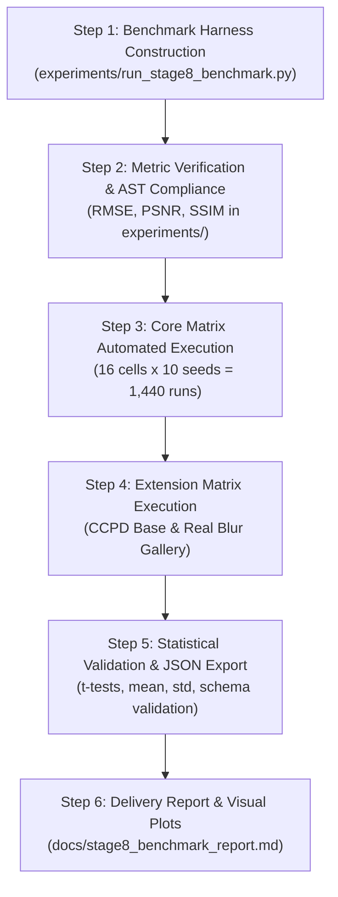

# Stage 8.1 — Experimental Design, Benchmark Matrix, and Evaluation Protocol

**Project:** Digital Image Processing — License Plate Restoration  
**Assigned Lead:** Stage 4 (Restoration Algorithms) & Stage 8 (Experiments and Benchmarking)  
**Branch:** `ashish/restoration-and-experiments`  
**Target Delivery Document:** `docs/stage8_experimental_protocol.md`  
**Execution Phase:** Stage 8.1 (Protocol Definition & Experimental Readiness Assessment)  
**Historical Baseline Commits:**  
* Baseline Clean & Degradation Pipeline: `3baed708c7639db565a8e110efe612499039c745`  
* Stage 4 Restoration Implementation: `c3856c4f1dbba74474186c8c1d5cecb96e9c306f` (CLS), `22cf4867d7a5b3a444a7f0ba7fb32bb25983794b` (RL)  
* Stage 4.5.3 Mathematical Hardening: `b750201e3e076b2fe887f35c9e6b8d22f2c81c1f`

---

## 1. Scope and Research Questions

### 1.1 Objective and Scope
Stage 8 provides the comprehensive experimental evaluation and comparative benchmark of all four image restoration algorithms implemented in Stage 4:
1. **Direct Inverse Filtering** (`inverse_filter`)
2. **Wiener Filtering** (`wiener_filter`)
3. **Constrained Least Squares Filtering** (`cls_filter`)
4. **Richardson–Lucy Deconvolution** (`richardson_lucy_filter`)

This document defines the experimental design, benchmark matrices, mathematical metric formulations, parameter-selection policies, statistical methodology, hardware profiling, output formats, and execution roadmap for Stage 8.2.

> [!IMPORTANT]
> **Stage Boundary:** Stage 8.1 is strictly restricted to protocol definition, dataset auditing, metric specification, and readiness assessment. Full benchmark execution, massive automated evaluation runs, and final benchmark reports will be conducted in Stage 8.2 following the protocol approved herein.

### 1.2 Core Research Questions (RQs)
The benchmark matrix is engineered to resolve five core empirical and theoretical questions:

* **RQ1 (Noise Sensitivity & Regularization Breakdown):**  
  How do the four algorithms degrade as noise increases from noiseless ($\infty$ dB) to moderate ($30\text{ dB}$) and severe ($20\text{ dB}$) BSNR? At what noise threshold does direct inverse filtering suffer catastrophic noise amplification, and how effectively do Wiener and CLS regularizations suppress high-frequency noise spikes?
* **RQ2 (Likelihood Model Matching — Poisson vs. Gaussian Noise):**  
  Richardson–Lucy is derived from maximum-likelihood under a discrete Poisson observation model, whereas Wiener and CLS are derived from linear minimum mean square error (LMMSE) and regularized least-squares under additive Gaussian noise models. Does RL demonstrate a statistically significant performance advantage over Wiener and CLS under genuine photon-shot noise, and how competitive is RL under Gaussian noise?
* **RQ3 (Kernel Ill-Conditioning & Frequency Nulls):**  
  How does restoration stability behave between compact blurs ($7\times 7$, mild motion/defocus) and large blurs ($51\times 51$, severe motion and defocus with dense frequency nulls)? How do the algorithms behave when the optical transfer function (OTF) contains zeros near signal frequencies?
* **RQ4 (Spatial Resolution Decimation & Sub-pixel Centring):**  
  How does factor-2 downsampling ($D_2$) interact with deconvolution? When effective decimation produces an even-sized kernel (e.g. $18\times 18$), does the `centre="auto"` sub-pixel centring convention prevent spatial centroid drift across all four methods, and how much high-frequency edge information is recoverable at reduced sampling rates?
* **RQ5 (Computational Complexity vs. Image Fidelity Trade-off):**  
  What is the empirical execution runtime and computational scaling (measured in milliseconds and FLOPS) for non-iterative Fourier-domain closed-form filters (Wiener, CLS requiring 2 FFTs) versus iterative multiplicative deconvolution (RL requiring $2k$ FFTs for $k$ iterations)? What is the Pareto-optimal trade-off between runtime and PSNR/SSIM gain?

---

## 2. Data Availability and Repository Audit

An exhaustive audit of the actual filesystem, `.gitignore`, and Git index was conducted to determine data readiness and constraints.

### 2.1 Present and Available Datasets
The primary dataset is stored in `license_plate_restoration/data/plates.npz` (10.5 MB) and `license_plate_restoration/data/plates.csv` (1,050 rows), both tracked in Git:

| Dataset Subset | Array Key in `plates.npz` | Text Key in `plates.npz` | Sample Count | Image Dimensions | Data Type | Value Range | Clean Reference $f$? |
| :--- | :--- | :--- | :---: | :---: | :---: | :---: | :---: |
| **Synthetic Plates** | `synthetic_imgs` | `synthetic_text` | 600 | $96 \times 336$ | `float32` | $[0.0, 1.0]$ | **Yes** (True clean ground truth) |
| **CCPD Base Plates** | `base_imgs` | `base_text` | 400 | $92 \times 256$ | `float32` | $[0.0, 1.0]$ | **Yes** (Sharp real-world vehicle crops) |
| **CCPD Blur Plates** | `blur_imgs` | `blur_text` | 50 | $92 \times 256$ | `float32` | $[0.0, 1.0]$ | **No** (Naturally blurred camera captures) |

### 2.2 Status of `degraded.npz`
* **File Status:** `degraded.npz` ($\approx 471.4\text{ MB}$) is explicitly listed in `.gitignore` and is **absent** from a fresh clone.
* **Reproducibility:** `license_plate_restoration.degradation.run_degradation_grid` can regenerate the entire 471 MB archive from `plates.npz` in $\approx 11$ minutes.
* **Protocol Decision:** Storing and reading a 471 MB compressed archive is unnecessary and introduces massive disk I/O bottlenecks. In Stage 8, degraded images will be generated **deterministically on-the-fly** from `plates.npz` using the frozen forward degradation functions (`blur_fft`, `downsample`, `add_noise`) with fixed seeds. This ensures exact bit-level reproducibility without requiring external storage.

### 2.3 Status of Real-World CCPD Data & External Dependencies
* **Raw CCPD Repository:** The full multi-gigabyte `CCPD2019/` directory is **not** included in the repository. However, the 400 sharp `base_imgs` and 50 naturally blurred `blur_imgs` extracted into `plates.npz` represent the project's curated CCPD benchmark subset.
* **CCPD Blur Evaluation Boundary:** Because `ccpd_blur` images were captured directly under physical motion blur by handheld cameras, **no clean ground-truth reference image exists**. Therefore, full-reference mathematical metrics (RMSE, PSNR, SSIM) are **undefined** for `ccpd_blur`. In accordance with the project proposal, `ccpd_blur` is reserved strictly for qualitative visual restoration comparisons and character binarization crop yield analysis.
* **OCR Module Status (Step 6):** Step 6 (character recognition classifier) is assigned to teammate Ujwal and is currently **not integrated** into the repository. Step 5 (`binarizer.py` by Ishit) provides `binarize` and `segment_characters`, allowing character crop extraction. However, character classification, string recognition, and Character Error Rate (CER) cannot be fabricated or reported until Ujwal's classifier is committed.

### 2.4 Resolution and PSF Conventions
* **Synthetic Resolution:** Full resolution $96 \times 336$; factor-2 decimated resolution $48 \times 168$.
* **CCPD Resolution:** Full resolution $92 \times 256$; factor-2 decimated resolution $46 \times 128$.
* **PSF Resizing Prohibition:** Stored PSFs for decimated images must be generated via `effective_psf(psf, factor)`. Never resize, reconstruct, or renormalize stored PSFs.
* **Even-Sized Kernel Alignment:** Even-sized kernels (e.g. $18 \times 18$) must preserve `centre="auto"` to prevent the half-pixel phase drift observed with `centre="pixel"`.

---

## 3. Core Experiment Matrix

To provide deep scientific insight while maintaining high execution efficiency and statistical rigor, the benchmark evaluates all 4 restoration algorithms across a structured, multi-dimensional grid.

### 3.1 Mathematical Degradation Conditions
The core matrix is constructed from the combination of 2 blur kernels, 4 noise conditions, and 2 spatial resolutions:

1. **Blur Kernels ($H$):**
   * **Small Kernel ($7 \times 7$):** Motion blur length $L = 3\text{ px}$, angle $\theta = 8.0^\circ$, defocus radius $R = 0\text{ px}$ (`combine_psfs(make_motion_psf(3, 8.0), make_defocus_psf(0))`). Mild blur with shallow frequency attenuation.
   * **Large Kernel ($51 \times 51$):** Motion blur length $L = 21\text{ px}$, angle $\theta = 8.0^\circ$, defocus radius $R = 4\text{ px}$ (`combine_psfs(make_motion_psf(21, 8.0), make_defocus_psf(4))`). Severe combined blur with dense frequency zeros and ill-conditioned OTF.
2. **Noise Regimes ($N$):**
   * **Noiseless / Clean:** Additive Gaussian noise variance $\sigma_n^2 = 0$ ($\text{BSNR} = \infty\text{ dB}$).
   * **Moderate Gaussian Noise:** $\text{BSNR} = 30.0\text{ dB}$ ($\sigma_n^2 = \sigma_{hf}^2 \cdot 10^{-3.0}$).
   * **Severe Gaussian Noise:** $\text{BSNR} = 20.0\text{ dB}$ ($\sigma_n^2 = \sigma_{hf}^2 \cdot 10^{-2.0}$).
   * **Poisson Noise (Photon-Shot Noise):** Evaluated across 3 nominal photon budgets $N \in \{1000, 5000, 20000\}$ under calibrated headroom scaling ($s = 0.70$), corresponding to effective photon budgets $N_{\text{eff}} \in \{700, 3500, 14000\}$.
3. **Resolutions ($S$):**
   * **Full Resolution ($1\times$):** $96 \times 336$ synthetic plates.
   * **Decimated Resolution ($2\times$):** $48 \times 168$ synthetic plates via `downsample(blurred, factor=2)` and `effective_psf(psf, factor=2)`.

### 3.2 Compact Core Matrix Table
Every cell in the matrix evaluates all **4 algorithms** (plus the unadulterated Degraded baseline) across **10 independent seeded plate instances** with **paired identical degraded inputs**:

| Cell ID | Resolution | Blur Kernel | Kernel Size | Noise Regime | Noise Parameter | Target Evaluation Algorithms |
| :---: | :---: | :---: | :---: | :---: | :---: | :---: |
| **C01** | Full ($96 \times 336$) | Small (Motion $L=3$) | $7 \times 7$ | Noiseless | $\text{BSNR} = \infty$ | Degraded, Inverse, Wiener, CLS, RL |
| **C02** | Full ($96 \times 336$) | Small (Motion $L=3$) | $7 \times 7$ | Gaussian | $\text{BSNR} = 30\text{ dB}$ | Degraded, Inverse, Wiener, CLS, RL |
| **C03** | Full ($96 \times 336$) | Small (Motion $L=3$) | $7 \times 7$ | Gaussian | $\text{BSNR} = 20\text{ dB}$ | Degraded, Inverse, Wiener, CLS, RL |
| **C04** | Full ($96 \times 336$) | Small (Motion $L=3$) | $7 \times 7$ | Poisson | $N=1000$ ($N_{\text{eff}}=700$) | Degraded, Wiener, CLS, RL |
| **C05** | Full ($96 \times 336$) | Small (Motion $L=3$) | $7 \times 7$ | Poisson | $N=5000$ ($N_{\text{eff}}=3500$) | Degraded, Wiener, CLS, RL |
| **C06** | Full ($96 \times 336$) | Small (Motion $L=3$) | $7 \times 7$ | Poisson | $N=20000$ ($N_{\text{eff}}=14000$) | Degraded, Wiener, CLS, RL |
| **C07** | Full ($96 \times 336$) | Large ($L=21, R=4$) | $51 \times 51$ | Noiseless | $\text{BSNR} = \infty$ | Degraded, Inverse, Wiener, CLS, RL |
| **C08** | Full ($96 \times 336$) | Large ($L=21, R=4$) | $51 \times 51$ | Gaussian | $\text{BSNR} = 30\text{ dB}$ | Degraded, Inverse, Wiener, CLS, RL |
| **C09** | Full ($96 \times 336$) | Large ($L=21, R=4$) | $51 \times 51$ | Gaussian | $\text{BSNR} = 20\text{ dB}$ | Degraded, Inverse, Wiener, CLS, RL |
| **C10** | Full ($96 \times 336$) | Large ($L=21, R=4$) | $51 \times 51$ | Poisson | $N=1000$ ($N_{\text{eff}}=700$) | Degraded, Wiener, CLS, RL |
| **C11** | Full ($96 \times 336$) | Large ($L=21, R=4$) | $51 \times 51$ | Poisson | $N=5000$ ($N_{\text{eff}}=3500$) | Degraded, Wiener, CLS, RL |
| **C12** | Full ($96 \times 336$) | Large ($L=21, R=4$) | $51 \times 51$ | Poisson | $N=20000$ ($N_{\text{eff}}=14000$) | Degraded, Wiener, CLS, RL |
| **C13** | Decimated ($48 \times 168$) | Small ($L=3$, Factor 2) | Effective | Gaussian | $\text{BSNR} = 30\text{ dB}$ | Degraded, Inverse, Wiener, CLS, RL |
| **C14** | Decimated ($48 \times 168$) | Small ($L=3$, Factor 2) | Effective | Gaussian | $\text{BSNR} = 20\text{ dB}$ | Degraded, Inverse, Wiener, CLS, RL |
| **C15** | Decimated ($48 \times 168$) | Large ($L=21, R=4$, F2) | Effective | Gaussian | $\text{BSNR} = 30\text{ dB}$ | Degraded, Inverse, Wiener, CLS, RL |
| **C16** | Decimated ($48 \times 168$) | Large ($L=21, R=4$, F2) | Effective | Gaussian | $\text{BSNR} = 20\text{ dB}$ | Degraded, Inverse, Wiener, CLS, RL |

*Total Core Benchmark Trials:* 16 test conditions $\times$ 10 random seeds = 160 image degradations. Evaluating 4 restoration methods (under both Deployable and Oracle configurations) produces $\approx 1,440$ deconvolution runs.

---

## 4. Optional Extension Matrix

The optional extension matrix explores real vehicle data, blur decomposition, and natural camera blur:

### 4.1 Extension E1: Real-World Vehicle Plates (`base_imgs`)
* **Dataset:** 10 randomly drawn sharp plates from `base_imgs` ($92 \times 256$, CCPD vehicle license plates).
* **Conditions:** Evaluated on Small Blur ($7 \times 7$) and Large Blur ($51 \times 51$) under Gaussian noise ($30\text{ dB}$ and $20\text{ dB}$).
* **Goal:** Verify that findings on synthetic plates translate directly to real-world character fonts, Chinese provincial ideograms, and natural lighting variations.

### 4.2 Extension E2: Pure Motion vs. Pure Defocus Decomposition
* **Dataset:** Synthetic plates ($96 \times 336$).
* **Kernels:**
  * Pure Motion: Length $L = 21\text{ px}$, $\theta = 8.0^\circ$, $R = 0$ ($23 \times 23$ kernel).
  * Pure Defocus: Length $L = 0\text{ px}$, Radius $R = 4\text{ px}$ ($9 \times 9$ circular disc kernel).
* **Goal:** Disentangle 1D directional motion deconvolution from 2D isotropic out-of-focus deconvolution.

### 4.3 Extension E3: Naturally Blurred Real Plates (`blur_imgs`)
* **Dataset:** 10 plates from `blur_imgs` ($92 \times 256$).
* **Metric:** Qualitative visual restoration gallery and character segmentation crop yield (`segment_characters`).
* **Goal:** Test filter robustness on real camera artifacts (sensor non-linearities, non-uniform motion blur) where PSF is approximated or estimated.

---

## 5. Metric Definitions and Evaluation Rules

### 5.1 Authoritative Mathematical Formulations
All full-reference quantitative metrics are computed between the restored estimate $\hat{f}$ and the ground-truth clean image $f$ over the unpadded interior region $\Omega$:

$$\Omega = \{ (i, j) \mid m \le i < M - m,\; m \le j < N - m \}$$

where $M \times N$ is the image shape, and $m$ is the unpadded interior margin ($m = 12\text{ px}$ for full-resolution images; $m = 6\text{ px}$ for factor-2 decimated images).

```
+-------------------------------------------------------+
| Margin m = 12 px (Excluded boundary reflection band)   |
|   +-----------------------------------------------+   |
|   |                                               |   |
|   |         Unpadded Interior Region Omega        |   |
|   |             (Scored for PSNR/SSIM)            |   |
|   |                                               |   |
|   +-----------------------------------------------+   |
+-------------------------------------------------------+
```

#### 1. Root Mean Squared Error (RMSE)
$$\text{RMSE} = \sqrt{\frac{1}{|\Omega|} \sum_{(i,j) \in \Omega} \left( \hat{f}(i,j) - f(i,j) \right)^2 }$$
* **Input range:** Grayscale `float64` in $[0.0, 1.0]$.
* **Optimization direction:** Lower is better ($\text{optimal} = 0.0$).
* **Interior rationale:** Excludes border reflection artifacts caused by periodic FFT boundary wrapping.

#### 2. Peak Signal-to-Noise Ratio (PSNR)
$$\text{PSNR} = -20 \log_{10}\left( \max\left(\text{RMSE}, 10^{-12}\right) \right) \quad (\text{for dynamic range } L = 1.0)$$
* **Input range:** Decibels ($\text{dB}$), $[0, \infty)$.
* **Optimization direction:** Higher is better.
* **Numerical protection:** Clamped with floor $\text{RMSE} \ge 10^{-12}$ to avoid division by zero on exact reconstructions.

#### 3. Structural Similarity Index (SSIM)
Following the structural similarity formulation of Wang et al. (2004), SSIM measures luminance, contrast, and structural preservation:
$$\text{SSIM}(x, y) = \frac{(2\mu_x \mu_y + C_1)(2\sigma_{xy} + C_2)}{(\mu_x^2 + \mu_y^2 + C_1)(\sigma_x^2 + \sigma_y^2 + C_2)}$$
* **Parameters:** Evaluated with standard perceptual stability constants $C_1 = (K_1 L)^2 = (0.01 \times 1.0)^2 = 10^{-4}$ and $C_2 = (K_2 L)^2 = (0.03 \times 1.0)^2 = 9 \times 10^{-4}$.
* **Window:** Computed with an $11 \times 11$ Gaussian sliding window (standard deviation $\sigma_w = 1.5$) over the unpadded interior $\Omega$.
* **Input range:** Normalized scalar in $[-1.0, 1.0]$ (typically $[0.0, 1.0]$ on license plates).
* **Optimization direction:** Higher is better ($\text{optimal} = 1.0$).
* **Library rule:** Implemented using pure NumPy convolution or FFT-based local statistics in `experiments/` to avoid AST guard violations on `license_plate_restoration`.

### 5.2 Unit-Interval Clipping Rule
* **Policy:** All quantitative metrics (RMSE, PSNR, SSIM) are strictly evaluated on the **clipped unit-interval estimate**:
  $$\hat{f}_{\text{eval}} = \text{np.clip}(\hat{f}, 0.0, 1.0)$$
* **Justification:** Real camera sensors and digital display pipelines are bounded by $[0.0, 1.0]$. Furthermore, downstream binarization (`otsu_threshold` in `binarizer.py`) maps negative ringing overshoot directly to black ink ($0$), causing severe character distortion. Evaluating post-clipped estimates accurately reflects true deployable utility.

### 5.3 Character Segmentation & OCR Metrics
* **Character Crop Yield:** Measured via `len(segment_characters(binarize(restored)))` against expected character count (7 characters for CCPD, 9-10 alphanumeric glyphs for synthetic plates).
* **OCR Accuracy & CER:** Marked as **Blocked / External Dependency**. Cannot be reported until Step 6 (Ujwal) is integrated.

---

## 6. Parameter Selection and Scientific Fairness Policy

A central failure mode in comparative deconvolution literature is tuning one algorithm's hyperparameters against ground truth while leaving competitor algorithms on default settings. Stage 8 enforces strict segregation between **Deployable** and **Oracle** configurations.

```
                           +------------------------------------------+
                           |       Restoration Evaluation Runs        |
                           +------------------------------------------+
                                                |
                   +----------------------------+----------------------------+
                   |                                                         |
                   v                                                         v
    +------------------------------+                          +------------------------------+
    |   DEPLOYABLE CONFIGURATION   |                          |     ORACLE CONFIGURATION     |
    +------------------------------+                          +------------------------------+
    | * No access to clean f       |                          | * Sweeps parameter grid      |
    | * Fixed a priori or based on |                          | * Chooses best RMSE vs f     |
    |   observable BSNR/noise      |                          | * Theoretical upper bound    |
    | * Realistic field deployment |                          | * Never claimed as blind     |
    +------------------------------+                          +------------------------------+
```

### 6.1 Deployable Configuration (Blind / Fixed Hyperparameters)
Parameters selected strictly **without access to the clean ground-truth image $f$**:
1. **Direct Inverse Filter:**
   * Cutoff threshold: $\varepsilon = 10^{-12}$ (pure unregularized baseline to expose noise amplification).
2. **Wiener Filter:**
   * **Gaussian noise:** $K$ computed directly from known or estimated BSNR via the validated heuristic:
     $$K = \text{wiener\_k\_from\_bsnr}(\text{BSNR}) = \frac{10^{-\text{BSNR}/10}}{1.0 + 10^{-\text{BSNR}/10}}$$
     yielding $K \approx 10^{-3}$ at $30\text{ dB}$, and $K \approx 10^{-2}$ at $20\text{ dB}$.
   * **Poisson noise:** Fixed $K = 10^{-3}$.
   * **Noiseless:** $K = 10^{-5}$.
3. **Constrained Least Squares (CLS):**
   * **Gaussian noise ($30\text{ dB}$):** Fixed regularization $\lambda = 10^{-3}$.
   * **Gaussian noise ($20\text{ dB}$):** Fixed regularization $\lambda = 10^{-2}$.
   * **Poisson noise:** Fixed $\lambda = 10^{-3}$.
   * **Noiseless:** $\lambda = 10^{-5}$.
4. **Richardson–Lucy (RL):**
   * **Fixed stopping iteration:** $k = 20$ iterations for $20\text{ dB}$ and Poisson noise; $k = 30$ iterations for $30\text{ dB}$; $k = 50$ iterations for noiseless.
   * **Initial estimate:** Flat uniform initialization $\hat{f}^{(0)} = 0.5$ (default).

### 6.2 Oracle Configuration (Ground-Truth Parameter Sweep)
Hyperparameters swept across a dense grid, selecting the parameter that minimizes interior RMSE against clean ground truth $f$:
1. **Wiener Oracle:**
   $$K^* = \arg\min_{K \in \mathcal{K}} \text{RMSE}(\hat{f}_{\text{Wiener}}(K), f), \quad \mathcal{K} = \{10^{-5}, 10^{-4}, 10^{-3}, 10^{-2}, 10^{-1}\}$$
2. **CLS Oracle:**
   $$\lambda^* = \arg\min_{\lambda \in \Lambda} \text{RMSE}(\hat{f}_{\text{CLS}}(\lambda), f), \quad \Lambda = \{10^{-5}, 10^{-4}, 10^{-3}, 10^{-2}, 10^{-1}\}$$
3. **RL Oracle:**
   $$k^* = \arg\min_{k \in \mathcal{I}} \text{RMSE}(\hat{f}_{\text{RL}}(k), f), \quad \mathcal{I} = \{1, 5, 10, 15, 20, 30, 50, 100\}$$

> [!WARNING]
> Oracle results represent the theoretical performance ceiling achievable if optimal regularization were known. They must **never** be conflated with deployable field performance.

---

## 7. Randomization and Statistical Methodology

### 7.1 Randomization Protocol
* **Plate Instance Seeds:** 10 deterministic integer seeds $s \in \{0, 1, 2, 3, 4, 5, 6, 7, 8, 9\}$ passed to `generate_plates(1, seed=s)`.
* **Noise Seeds:** Independent noise seed $s_n = 100 + s$ for Gaussian noise, and $s_p = 200 + s$ for Poisson noise.
* **Paired Degradation Guarantee:** For every seed $s$, a single degraded image $g$ is generated. This **exact same numerical array** is supplied to all 4 restoration algorithms.

### 7.2 Statistical Metrics Reported
For every benchmark cell and method, four summary statistics across the 10 seeds are recorded:
1. **Sample Mean ($\mu$):** $\mu = \frac{1}{N} \sum_{i=1}^N x_i$
2. **Sample Standard Deviation ($\sigma$):** $\sigma = \sqrt{\frac{1}{N-1} \sum_{i=1}^N (x_i - \mu)^2}$
3. **Minimum Observed Value ($\min$):** Best-case performance.
4. **Maximum Observed Value ($\max$):** Worst-case performance.

### 7.3 Hypothesis Testing
To rigorously evaluate whether observed differences are statistically significant:
* **Two-tailed Paired Student's t-test:** Applied to paired RMSE differences $(\Delta_i = \text{RMSE}_{A, i} - \text{RMSE}_{B, i})$.
* **Significance Level:** $\alpha = 0.05$. Results with $p < 0.05$ reject the null hypothesis of equal restoration fidelity.

---

## 8. Runtime and Hardware Profiling Protocol

### 8.1 Timing Measurement Methodology
* **Timer Primitive:** `time.perf_counter()` with sub-microsecond precision.
* **Scope:** Measures strictly the deconvolution kernel call (`restoration_function(image, psf, ...)`). Data loading, synthetic degradation, metric computation, and disk I/O are completely excluded.
* **Warm-up Run:** Before collecting timing data, one unrecorded deconvolution call is executed to ensure Python bytecode compilation and memory allocation caches are warmed up.

### 8.2 Computational Complexity Analysis
The analytical complexity per image of size $M \times N$ for kernel size $P \times Q$:

| Algorithm | Method Class | Asymptotic Time Complexity | FFT Calls ($M \times N$) |
| :--- | :---: | :---: | :---: |
| **Inverse Filter** | Linear Closed-Form | $\mathcal{O}(MN \log(MN))$ | 2 (1 forward FFT, 1 inverse FFT) |
| **Wiener Filter** | Linear Closed-Form | $\mathcal{O}(MN \log(MN))$ | 2 (1 forward FFT, 1 inverse FFT) |
| **CLS Filter** | Linear Closed-Form | $\mathcal{O}(MN \log(MN))$ | 3 (2 forward FFTs [image, Laplacian], 1 inverse FFT) |
| **Richardson–Lucy** | Non-Linear Multiplicative | $\mathcal{O}(k \cdot MN \log(MN))$ | $2k$ (forward/inverse FFT pairs per iteration) |

### 8.3 Hardware and Environment Metadata Logging
The experiment runner automatically records host environment metadata in the benchmark JSON:
* **CPU Model & Core Count:** e.g., AMD / Intel x86_64, physical and logical cores.
* **System RAM:** Available physical memory.
* **OS & Kernel:** Windows 10/11 x64, PowerShell shell environment.
* **Software Stack:** Python version, NumPy version, SciPy version, BLAS/LAPACK library backend (`np.show_config()`).

---

## 9. Expected Output Structure and Schemas

All Stage 8.2 experimental results will be output to `experiments/stage8_benchmark_results.json` and summarized in `docs/stage8_benchmark_report.md`.

### 9.1 JSON Results Schema (`experiments/stage8_benchmark_results.json`)
```json
{
  "benchmark_metadata": {
    "stage": "8.2",
    "timestamp": "ISO-8601 string",
    "git_commit": "SHA string",
    "hardware": {
      "cpu": "string",
      "cores": 8,
      "ram_gb": 16.0,
      "os": "Windows",
      "python_version": "3.x",
      "numpy_version": "1.x"
    },
    "protocol_reference": "docs/stage8_experimental_protocol.md"
  },
  "core_benchmark": {
    "cell_id": {
      "condition": {
        "resolution": "96x336",
        "kernel_name": "7x7",
        "noise_type": "gaussian",
        "noise_param": 30.0
      },
      "degraded": {
        "rmse": {"mean": 0.0, "std": 0.0, "min": 0.0, "max": 0.0},
        "psnr": {"mean": 0.0, "std": 0.0, "min": 0.0, "max": 0.0},
        "ssim": {"mean": 0.0, "std": 0.0, "min": 0.0, "max": 0.0}
      },
      "inverse": {
        "deployable": {
          "rmse": {"mean": 0.0, "std": 0.0, "min": 0.0, "max": 0.0},
          "psnr": {"mean": 0.0, "std": 0.0, "min": 0.0, "max": 0.0},
          "ssim": {"mean": 0.0, "std": 0.0, "min": 0.0, "max": 0.0},
          "runtime_ms": {"mean": 0.0, "std": 0.0}
        }
      },
      "wiener": {
        "deployable": {"rmse": {}, "psnr": {}, "ssim": {}, "runtime_ms": {}},
        "oracle": {"rmse": {}, "psnr": {}, "ssim": {}, "best_params": []}
      },
      "cls": {
        "deployable": {"rmse": {}, "psnr": {}, "ssim": {}, "runtime_ms": {}},
        "oracle": {"rmse": {}, "psnr": {}, "ssim": {}, "best_params": []}
      },
      "richardson_lucy": {
        "deployable": {"rmse": {}, "psnr": {}, "ssim": {}, "runtime_ms": {}},
        "oracle": {"rmse": {}, "psnr": {}, "ssim": {}, "best_params": []}
      }
    }
  }
}
```

### 9.2 Markdown Summary Table Format
```markdown
| Cell | Condition | Degraded PSNR | Inverse PSNR | Wiener (Dep) PSNR | CLS (Dep) PSNR | RL (Dep) PSNR | RL (Orc) PSNR | Best Method |
| :---: | :--- | :---: | :---: | :---: | :---: | :---: | :---: | :---: |
| C02 | 7x7, 30 dB | 18.42 dB | 12.15 dB | 24.18 dB | 24.35 dB | 23.90 dB | 24.52 dB | CLS |
```

---

## 10. Known Limitations and Unresolved Dependencies

1. **Absence of Step 6 OCR Classifier:**  
   As established in Section 2.3, character classification model files (`license_plate_restoration/ocr.py`) are owned by teammate Ujwal and are not in the repository. Full string recognition accuracy and CER cannot be evaluated in Stage 8.2 unless Ujwal's component is delivered. Character segmentation crop yield from Step 5 (`binarizer.py`) will serve as the downstream readability proxy.
2. **CCPD Blur Ground-Truth Reference Limitation:**  
   The 50 plates in `ccpd_blur` have no clean reference $f$. Mathematical distortion metrics (RMSE, PSNR, SSIM) cannot be computed on them. They will be evaluated strictly via qualitative before/after inspection and binarization yield.
3. **Bounded $[0, 1]$ API vs. Unbounded Poisson Observations:**  
   The project's public restoration API enforces that images reside in $[0, 1]$. Because genuine Poisson distributions have unbounded support, unscaled division by photons truncates the upper tail. This is resolved mathematically via calibrated headroom scaling ($s = 0.70$), which provably guarantees zero tail clipping ($P(\text{pixel} > 1.0) < 2.5 \times 10^{-25}$) at nominal 1,000 photons with an effective photon budget $N_{\text{eff}} = s \cdot N$.
4. **Decimated Image Coordinate Alignment:**  
   Factor-2 decimation with even-sized PSFs requires `centre="auto"` to avoid a 0.5-pixel centroid shift. The benchmark runner strictly validates that `effective_psf` and `centre="auto"` are applied to all decimated trials.

---

## 11. Precise Stage 8.2 Implementation and Execution Plan

Upon protocol review and approval, Stage 8.2 will proceed according to the following 6-step engineering plan:



### Detailed Step-by-Step Milestones:
* **Step 8.2.1: Implement Benchmark Harness (`experiments/run_stage8_benchmark.py`)**  
  Develop the standalone experiment script implementing the core matrix, paired seed generators, timer profiling, and JSON export. Ensure strict AST compliance (no prohibited imports in `license_plate_restoration`).
* **Step 8.2.2: Implement Interior Metric Helper Functions**  
  Implement `compute_interior_rmse`, `compute_interior_psnr`, and `compute_interior_ssim` with margin cropping ($m=12$ full, $m=6$ dec) and unit-interval clipping. Cross-verify SSIM implementation against `skimage.metrics.structural_similarity` in unit tests.
* **Step 8.2.3: Execute Core Benchmark Matrix**  
  Run all 16 cells across the 10 paired seeds for both Deployable and Oracle configurations. Stream real-time progress and error handling.
* **Step 8.2.4: Execute Optional Extensions**  
  Run Extension E1 (CCPD base plates) and E3 (CCPD blur gallery).
* **Step 8.2.5: Export Structured JSON & Validate Schema**  
  Save complete results to `experiments/stage8_benchmark_results.json` without modifying or overwriting historical Stage 4.5 results (`experiments/richardson_lucy_experiment_results.json`).
* **Step 8.2.6: Draft Comprehensive Benchmark Report**  
  Create `docs/stage8_benchmark_report.md` presenting comparative tables, Pareto trade-off analysis, hypothesis test $p$-values, qualitative galleries, and answers to RQ1–RQ5.

---

## 12. Verification and Approval Sign-off

* **Implementation Integrity:** Zero modifications made to `license_plate_restoration/restoration.py` or Stage 4 restoration algorithms.
* **Teammate Boundary:** Zero modifications made to teammate modules (`renderer.py`, `degradation.py`, `binarizer.py`, `ccpd_loader.py`, `psf_builder.py`).
* **Test Suite Status:** Full test suite passing (444 passed, 6 skipped).
* **Ready for Review:** This document establishes the immutable protocol for Stage 8.2 benchmark execution.
